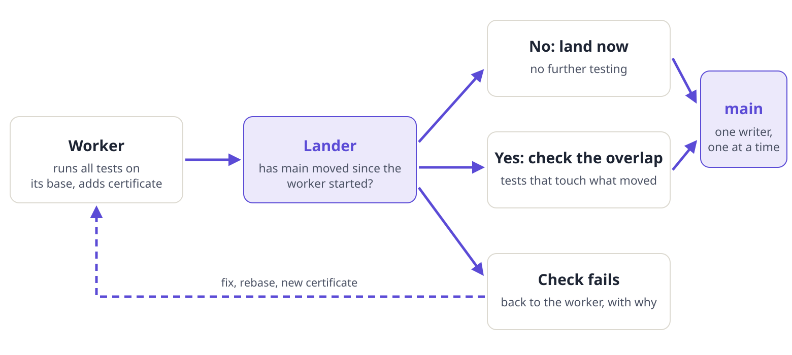

::: summary
### The short version

- **The trouble.** With dozens of agents changing one codebase at once, the old routine (a branch, a full test run, a wait in line) falls behind. Branches go stale, pushes bounce, and everyone rebases again and again.
- **The real problem is conflict, not landing.** At lung's volume the lander is busy 6% of the time, yet 44% of changes open together touch the same file. A merge queue does not fix that; fixing the hot files and reserving work first does (the box after this summary).
- **Use the queue if you have one.** Where a merge queue exists, use it; this design is mostly for repositories that cannot have one, and for very high volume. Section 1 says what to keep either way.
- **The idea.** Let each worker run the full tests on its own machine and attach a signed-off note, a *certificate*, saying which version of main it tested against. The lander then does only a small check. If main has not moved, it lands the change at once. If main has moved, it runs only the tests that touch what moved.
- **The safety net.** One writer updates main, one change at a time. If a landed change breaks the later full checks, main freezes and an automatic revert puts it right.
- **Lung, as measured.** Lung is a personal-account repository, so no merge queue is available to it, and its serial lander is the built substitute. It already has the plumbing (a worktree per task, one lander at a time, two tiers of checks, a revert watchdog). It has no certificate, no overlap check, and no working freeze. Main is red on most recent pushes for a reason that is not the code, and that comes first (page: Applied to lung).
:::

::: summary
### The real problem at low throughput is conflict, not landing

A merge queue fixes how changes are lined up and tested. It does nothing about two changes that edit the same lines or the same files, and in a codebase with a few hot files that is what hurts, even at a few commits a day.

**Measured on lung:** about 2.3 commits an hour and the lander busy 6% of the time, yet 44% of changes open together touched the same file, and about half of all open pull requests needed a conflict rebase. The Spire venue shows the same pattern: low volume and many merge conflicts.

For systems like these the conflict work comes first and the landing mechanism second:

1. **Restructure hot files** so independent changes do not touch the same lines: split large files along real seams, replace shared registration lists and baselines with one entry per file or generated lists, and keep generated files out of hand edits.
2. **Reserve before you start.** When work is assigned, declare the files or functions it will change, and refuse or queue a second assignment that overlaps. The cheapest conflict is the one never created.
3. **Keep changes small and short-lived** (150 lines, 45 minutes), so a branch has less time to be overlapped.
4. **Land often and in order**, behind a queue where there is one, so the overlap window is minutes, not days; bring long-open changes to the front or close them.
5. **Make conflicts cheap.** Regenerate generated files instead of merging them by hand, and have the lander rebase mechanically.
:::

## With a merge queue, and without one

Read this section first. It says which parts of the design to keep, which to drop, and which to build only when no merge queue is available. It also says plainly that a merge queue is not the answer to merge conflicts.

**Where a merge queue exists.** GitHub offers a merge queue for repositories owned by an organization (for private ones, on the plan that includes it). It lands changes one at a time, tests the exact combination of each change with current main, removes the "branch must be up to date" friction, and merges on its own. GitHub runs it from events, so it cannot sit idle while mergeable changes wait. At up to about 60 commits a day with checks of 5 minutes or less, a merge queue is the right way to land, and nothing in this design replaces it.

**Where it does not exist.** A repository on a personal account has no merge queue. There the same job falls to a lander we build: a single writer that rebases, runs the pre-landing checks on the combined result, and merges. It must run from events (a workflow), not as a loop inside an agent, because an agent loop stalls.

**Keep in both cases** (a queue provides none of these):

- Repeatable results: sorted listings, ordered iteration, no shared fixed temporary paths, tests that do not depend on the machine, and a check with a failing self-test. A flaky test turns main red and no queue prevents that.
- Edits that do not collide: restructure the hot registration files, lists and baselines so independent changes do not touch the same lines. A queue ejects a colliding change; it does not resolve it.
- Two tiers: Tier 1 under 60 seconds before landing, Tier 2 after.
- One definition of red, written once and used by every tool: the Tier 1 job of the latest finished push on main has failed. A Tier 2 failure freezes ordinary changes and starts the watchdog; it does not block forever.
- A watchdog that re-checks the head before reverting. It never reverts infrastructure failures, never reverts a commit that a later commit already fixed, and finds the real cause. A hasty revert on a false red removes good work.
- The working rules for agents (appendix A), hard limits on what one change may touch, and a record of who or what landed it.

**A merge queue makes these unnecessary** (build them only without one): the single-writer lander itself (the lock, the rebase-and-retry loop, the wait for the pull request head to sync, the freeze check in front of the merge); the "branch must be up to date" workaround; and a scheduled sweep of ready changes.

**Only for very high volume or slow, costly checks** (design B, or a queue whose checks cost real money): the certificate and the overlap check, and the single writer pushing straight to main. Above about 60 commits a day, or when each check is slow or billed, running only the tests that touch what changed saves real cost. Inside a queue, test selection is the required check; it does not replace the queue. The worker writes its own certificate, so the lander must recompute the diff hash and verify it.

**Optional research value:** writing the lander's decision rules as a proved Lean specification. It matters only when the lander is ours, which means when there is no queue. It is a good first trial of the method on a control plane, not a product requirement where GitHub's queue is available.

| Element | With a merge queue | Without one (personal repository) |
|---|---|---|
| Landing one at a time, testing the combination | The queue | Build a single-writer lander |
| Branch up to date before merge | The queue removes it | The lander waits for the head to sync and rebases |
| Never idle | GitHub runs it | The lander must be a workflow, not an agent loop |
| Freeze on red main | Group checks fail on a red main; add a freeze marker only for non-fix changes | Needed |
| Tier 2 and the revert watchdog (re-check the head first) | Needed | Needed |
| Repeatability checks | Needed | Needed |
| Edits that do not collide, and reservations when work is assigned | Needed: the main cure for conflicts at low volume | Needed |
| Test selection from the dependency graph | Optional cost saver, as the required check | Optional cost saver |
| Certificate and empty-change shortcut | Not needed at design A volumes | Optional; needed only above about 60 commits a day |
| Single writer pushing direct to main | Not needed | Needed only at design B volumes |
| Lander specified and proved in Lean | Not needed | Optional research value |
| Agent working rules and limits | Needed | Needed |

: Table 1. With and without a merge queue. Source: the design note, section 2A.

## The problem

When agents work without a person reviewing each change, main is the shared memory of the whole swarm. Every agent builds its picture of the code from a snapshot of main. The longer a branch lives, the further that snapshot is from the real thing, and three things go wrong.

1. **Drift.** The amount of change a branch has to catch up on is the total of everything landed on main since it began. The more commits land per hour, the faster a branch goes stale, and the more an agent has to read just to see what changed.
2. **Stale pictures.** An agent keeps writing against functions and types that another agent has already changed or deleted.
3. **Quiet conflicts.** Two changes can merge without a text conflict and still break each other, for instance by changing what a function promises or the order of steps. Nothing flags it until something fails.

The usual pipeline makes this worse. It runs the whole test suite, in turn, for every change. With many agents landing at once the line grows, branches fall behind while they wait, pushes are refused because main moved, and agents rebase again. Work churns without finishing.

## Two ways to land

There are two designs that stop the line from collapsing. The choice depends on how many changes land per day and how long the checks take.

| Question | A: merge queue | B: one writer, straight to main |
|---|---|---|
| How much work | Up to about 60 commits a day | More than 60 a day |
| How fast the checks must be | Whole check in 5 minutes or less (2.5 under load) | A pre-check of 60 seconds or less, then full checks after landing |
| How a change lands | A short-lived branch goes into an automatic queue that tries it against current main and lands it | The worker rebases in its own copy, a single lander takes the lock and pushes to main |
| Record of what happened | The pull request history | Signed commits and an append-only log |
| How it fails | Line builds up, rebases repeat | A bad change reaches main briefly and must be undone fast |

: Table 2. The two landing designs. Source: the design note, section 2.

Design A fits when the load is modest, checks are quick, and changes often break each other. Design B fits when volume is high and checks run longer than 2.5 minutes, because a one-at-a-time queue then cannot keep up. B needs the after-landing watchdog described below.

## The delta proof

The aim is to keep the slow work (the full tests) away from the one step that must happen in single file (the write to main). Workers do the slow work, in parallel, in their own copies. The lander only holds the lock for a quick update.



A worker runs the full tests on the version of main it started from, call it C, and records the result in a certificate. The lander rejects any submission without a valid certificate for the version it claims.

| Field | What it holds |
|---|---|
| Submission id | A unique number for this attempt |
| Base | The exact version of main the worker started from (40 characters) |
| Diff hash | A fingerprint of the change, so the certificate cannot be moved to a different change |
| Suite status | Pass or fail |
| Affected contracts | The parts of the code whose promises this change touches |

: Table 3. The certificate. It travels as lines in the commit message or in a side record in the repository.

The lander then takes one of two roads.

1. **Nothing has landed since C.** Main is still exactly where the worker tested, so the change is landed at once with no more testing.
2. **Something has landed since C.** The lander tries the two together in a scratch copy and runs only the tests that touch both the submitted change and what moved, plus the checks for repeatable results. If no tests touch both, this takes seconds.

The work of the lander is therefore bounded by how far main has moved, not by the size of the whole codebase.

### Repeatable results

A certificate is only worth something if the tests give the same answer every time. Before certifying, the worker runs checks that catch the usual causes of different answers: listing files or items in whatever order the system gives them (always sort), unordered key lists, and searches whose results arrive in unpredictable order. If a result ever differs between runs, the certificate is void and the landing is refused.

### When the check fails

The lander stops, and sends the exact failure back to the worker that submitted. The worker rebases in its own copy, fixes the collision, and gets a fresh certificate. The effort returns to the many workers instead of piling up at the centre.

### Changes that do not collide

If two changes touch different functions or different modules, applying them in either order gives the same result. So they can be handled together and landed in any order without voiding each other's certificates. Where they would touch the same thing, a reservation made before the work starts (a lock on that file or function) keeps the second worker waiting instead of colliding.

## Working rules for agents

The design relies on small, safe changes. These are the habits it asks of every worker. The full text is appendix A.

| Rule | Detail |
|---|---|
| Own copy of the code | Each task works in its own worktree, cut from the current main |
| Time limit | A worktree with no passing small change after 30 to 45 minutes is thrown away and the task is split |
| Small changes | At most 150 lines of real code per commit; larger work is split in steps |
| Switches default off | New behaviour is behind a switch that starts off, so unfinished work can land safely |
| Replace in steps | Add the new next to the old, move callers over a few at a time, then delete the old |
| Rename in steps | Never drop or rename a database field in one go: add, then move readers and writers, then remove |
| Two tiers of checks | Tier 1 before landing, under 60 seconds. Tier 2 after landing, under 5 minutes |
| Standard commit notes | Conventional commit titles with fixed lines (Task-ID, Agent-Run, Feature-Flag, Certificate-Base) a script can read |

: Table 4. Working rules. Source: the design note, section 4.

Tier 1 holds the type check, a warnings-as-errors build, the tests affected by the change, and the repeatability checks. Tier 2 holds the full integration tests, fuzzing, speed checks, and a watchdog that keeps testing the head of main.

## Keeping main healthy

If Tier 2 fails on main, main is red. While it is red:

- The lander refuses all ordinary submissions, so nobody builds on a bad base.
- It accepts only a revert or a designated hotfix.
- A watchdog reverts the failing commit straight away, then files a diagnostic task for a repair agent to work on in a clean copy.

Agents may not try to fix forward on a broken main. They pull the revert, reproduce the problem in a fresh worktree, and submit again with a new certificate.

Under design B, workers may not push to main directly. They send the commit and certificate to a single coordinator, which rebases, checks, and pushes inside a short lock, normally tens of milliseconds.

## Rollout in four phases

| Phase | Weeks | What lands |
|---|---|---|
| 1. Agree the protocol | 1 to 2 | The root AGENTS.md, worktree per task, time limit, small commits, repeatability checks, local Tier 1 |
| 2. Certificates and the lander | 3 to 4 | Certificates from the worker, the lander with its empty-change shortcut, failures sent back to workers |
| 3. Guardrails | 5 to 6 | Freeze on red through branch protection, the Tier 2 watchdog, standard commit lines |
| 4. Many writers | 7 and on | Reservations on functions or files, parallel checks for unrelated changes, then the single coordinator |

: Table 5. The rollout. Source: the design note, section 7.

## Going further: machine-checked proofs

For safety-critical code, the certificate can be a mathematical proof checked by the Lean 4 proof assistant in place of a test log. The worker proves that its change keeps the promises of each interface; the lander checks the proof without re-reading the code. When the changes that landed in between leave those promises alone, the lander accepts the combination from the proofs alone. The lander's own rules can also be written in Lean, so its decisions are checked by a kernel and not left to shell scripts, and unordered iteration can be made impossible to write at all.

## Applied to lung {.newpage}

Sources: a read-only study of lung at main version 97f75f0, which changed no repository.

**In one line.** Lung has the plumbing of this design but not its proof objects. It has a worktree per task, one lander at a time, two tiers, ratchets with self-tests and a revert watchdog. It has no certificate, so the lander runs the whole of Tier 1 for every change. It has no overlap check, no way to make edits commute (44% of changes that are open at once touch the same file), a freeze that has not landed, and landing decisions made in shell, not in the spec.

**Do first.** Main is red on 24 of the last 40 pushes, because of the way Tier 2 checks out the code and not because of any commit. Until that is fixed, a working freeze would freeze lung for good.

| Measure | Value |
|---|---|
| Commits on main per day (Nov 1 to 4) | 109, 62, 41, 24 |
| Busiest hour | 30 commits |
| Pull requests open at once | 5.8 on average |
| Pull request open to merge | Median 20 min, 75th percentile 198 min, 90th percentile 525 min |
| Tier 1 on a warm machine | About 55 to 64 seconds |
| Tier 1 and Tier 2 on the runner | 257 seconds and 8.4 minutes |
| Lander lock held | About 1 minute (6% busy at 3.8 an hour, about 50% at the peak) |
| Changes touching no code or spec | 35 of 58 |
| Changes over 150 lines | 15 of 58 |

: Table 6. What lung measures. The wait is for the lander's turn, not for the checks.

| Element | Status | What lung has, or what it lacks and why |
|---|---|---|
| Which design (A or B) | Keep A | Lung is a personal-account repository, so GitHub's merge queue is not available. The serial lander under a file lock plus a merge pinned to the head commit is the hand-made queue we built because of that. Lock time times rate is 6%, so design B buys nothing yet. Write down the trigger: more than 60 a day sustained and more than 50% lock use |
| Certificate | Missing | No certificate and no Certificate-Base line (0 of 60). Task-ID is on 57 of 60, Agent-Run on 56, Feature-Flag on 54, and conventional titles on 60. No hook checks any of them |
| Overlap check | Missing | The lander always rebases and runs the full Tier 1. It would gain most on docs, scripts and spec-only changes (60% of changes). Edits to the agent code touch most modules (96 of 112), so the overlap there is seldom empty |
| Reservations | Missing | Do commuting first. 111 of 237 concurrent pairs share a file; removing five shared edit points leaves 36 (65% fewer). File-level locks are enough; function-level is not worth it |
| Edits that commute | Missing | The test list in tier1.sh, the check list in Check.lean, the spec umbrella file and two bookkeeping files are edited by nearly every change. Generate each from a sorted listing, with a freshness check and a failing self-test |
| Single writer | Partial | Has one lock, a scratch worktree, rebase, ratchet, Tier 1, a lease push, retry up to 3 times. Lacks the certificate check, the shortcut, freeze, trailer, size and time checks, and failures returned as data. A lander agent runs it, hence the 198-minute tail |
| Freeze on red | Missing | Only an opt-in halt that nobody sets. An open pull request adds a check, but its exemption is a title anyone can write, and it would freeze everything while main is red for a false reason |
| Revert watchdog | Live, misfiring | Merged on Nov 4. It reverted a good commit because Tier 2 failed on a shallow checkout, could not open its pull request, and left 12 stray branches and 18 open issues |
| Switches and replace in steps | Have, different | Lung uses reachability: a spec module lands unwired and a later change wires it, checked mechanically. Better than a runtime switch for a verified core. Missing: a check that a change adding behaviour says so |
| Commit lines | Have, no check | Titles follow the rule 60 of 60; nothing enforces it. About 25 lines of checking would do |
| Time and size limits | Missing | Only words in AGENTS.md. The 150-line rule is broken 26% of the time, so make it a check with a waiver line, tightened over time. The time limit belongs to the task manager |
| Repeatable results | Have (shell), missing (Lean) | Shell lints exist with self-tests. Missing: unordered directory reads and hash-map loops in Lean, and a rerun-and-compare for flaky tests |
| Lander as spec | Missing | No landing module in the spec. Wanted: states, steps and theorems (lands only when base is head or the overlap check passed; frozen admits only revert or fix; one change per step), then a small Lean program replaces the shell policy |

: Table 7. Lung against the design: have and missing. Source: the delta map for lung.

| Slice | What | Needs |
|---|---|---|
| S0 | Fix the false reds in Tier 2 (full checkout, watchdog skips infrastructure failures). About 10 lines | Nothing; gate for S1 and trust in main |
| S1 | Land the open freeze check and fix its exemption. About 20 lines | S0 |
| S2 | Make edits commute: four independent changes (test list, check list, spec umbrella, bookkeeping files) | Nothing |
| S3 | Certificate: write and verify. About 90 lines | S0 for trust in main |
| S4 | Lander shortcut for empty change, then the overlap selection. About 40 then 110 lines | S3 |
| S5 | Land-time checks: commit lines, size, real Agent-Run. About 70 lines | Nothing |
| S6 | Repeatability: Lean directory and hash-map lint, rerun-and-compare. About 60 lines | Nothing |
| S7 | Lander as Lean spec, then the decision program replaces the shell policy | S1 and S4 |
| S8 | Lander as a service that picks up green pull requests, removing the long tail | S1 and S4 |

: Table 8. The ordered slices. Source: the delta map for lung.

| Piece | Why lung builds it |
|---|---|
| Single-writer lander (file lock, rebase, retry, merge pinned to the head commit) | A queue would do this; lung has none |
| Wait for the head to sync and the freeze check in front of the merge | The queue would do both |
| A lander that runs from events | At present an agent runs it, which stalls; slice S8 makes it a service or workflow |
| Certificate and overlap check (S3, S4) | Optional here: lung is at the design A volume, so these are cost savers, not requirements |
| Lander as a Lean spec (S7) | Optional research value, and it applies because the lander is lung's own |

: Table 9. Pieces lung builds only because it has no merge queue.

::: q
### Questions for the owner
1. Stay on design A? **Recommended: yes**, and record the trigger for B.
2. Should Tier 2 repeat Tier 1? **No.** It costs 4.3 of its 8.4 minutes; run the build and ratchets only.
3. Sign certificates? **Not yet.** Everything runs as one user, so a signature adds nothing; bind to the tree and revisit with a second host.
4. How is a fix to a red main let through? **Only if the change touches nothing outside tests and CI files**; a title is forgeable.
5. Does a Tier 2 failure that also fails on the parent get reverted? **No.** Open an issue; no revert and no freeze beyond one run.
6. May the spec umbrella file be generated without the owner? **Yes**, if a check proves it is exactly the sorted module list.
7. Is the 150-line limit hard? **No:** tighten gradually, with a waiver line.
:::

## Appendix A: the AGENTS.md text {.newpage}

Place this at the root of every repository. Agents read it when they start. It is the short form; the design note's longer form adds the same rules with a few more details.

~~~~markdown
# Autonomous Trunk-Based Development Protocol

## 1. Workspace & Branch Lifecycle
- Always start from a fresh synchronization of trunk: `git fetch origin && git rebase origin/main`.
- Operate strictly within an isolated ephemeral Git worktree per task (`git worktree add ../wt-<task-id> -b agent/<task-id> origin/main`).
- Scope limit: Diffs must not exceed 150 lines of production code. If a task requires larger changes, halt execution and output a decomposition plan using Branch by Abstraction.
- Hard TTL: Any worktree older than 45 minutes without a passing build must be aborted and decomposed.

## 2. Defensive Coding Mandates (Zero Broken Trunk)
- Every commit must compile cleanly with zero warnings and pass all Tier 1 pre-flight checks.
- Incomplete features, new endpoints, or behavioral changes MUST be gated behind a programmatic feature flag defaulting to `false`.
- Breaking changes to shared interfaces or schemas are forbidden. Use the Expand-and-Contract pattern:
  1. Add new interface/field alongside legacy code.
  2. Migrate callers incrementally across micro-commits.
  3. Remove legacy code only when zero references remain.
- Enforce strict determinism: Sort all listings, map keys, and iteration paths.

## 3. Pre-Landing Verification & Base Certificate
Before submitting code to the Delta Lander:
1. Rebase onto latest trunk: `git fetch origin main && git rebase origin/main`.
2. Execute fast static analysis, type checking, and affected unit tests (Tier 1 <60s).
3. Attach the Base Certificate trailer to your commit message:

feat(auth): implement token refresh retry mechanism

Task-ID: TASK-1024
Certificate-Base: 4f8b9a2c...
Certificate-Status: PASS

## 4. Failure & Rollback Protocol
- Never force-push directly to `main`.
- If a commit breaks post-merge verification, the system will automatically revert it. Do not attempt hotfixes directly on trunk; pull the revert, reproduce the failure in a new ephemeral worktree, and re-submit.
~~~~

## Appendix B: the lander for repositories without a merge queue {.newpage}

**Scope.** This workflow is the lander for repositories without a merge queue, such as one on a personal account. Where a merge queue exists, use it and keep only the parts listed in section 1.

A GitHub Action for the lander: it reads the certificate from the commit, compares main with the claimed base, lands at once when main has not moved, and otherwise runs the checks that touch the overlap. It is a sketch to learn from, not a drop-in. The review notes follow it, with the fixes to make before use.

```yaml
name: Agentic Delta Lander

on:
  pull_request:
    types: [opened, synchronize, labeled]

jobs:
  delta-evaluator:
    runs-on: ubuntu-latest
    permissions:
      actions: read
      contents: write
      pull-requests: write

    steps:
      - name: Checkout Repository
        uses: actions/checkout@v4
        with:
          fetch-depth: 0

      - name: Verify Main Branch Health (Freeze-on-Red Gate)
        run: |
          MAIN_STATUS=$(gh run list --branch main --workflow "Continuous Integration" --limit 1 --json conclusion -q '..conclusion')
          if [ "$MAIN_STATUS" = "failure" ]; then
            echo "::error::Main branch is currently RED. Merges frozen until baseline is restored."
            exit 1
          fi
        env:
          GH_TOKEN: ${{ secrets.GITHUB_TOKEN }}

      - name: Extract Base Certificate
        id: cert
        run: |
          PR_HEAD_SHA="${{ github.event.pull_request.head.sha }}"
          BASE_SHA=$(git log -1 --format="%(trailers:key=Certificate-Base,valueonly=true)" $PR_HEAD_SHA | tr -d ' ')
          STATUS=$(git log -1 --format="%(trailers:key=Certificate-Status,valueonly=true)" $PR_HEAD_SHA | tr -d ' ')

          if [ -z "$BASE_SHA" ] || [ "$STATUS" != "PASS" ]; then
            echo "::error::Missing or invalid Base Certificate trailer (Certificate-Base / Certificate-Status)."
            exit 1
          fi

          echo "base_sha=$BASE_SHA" >> $GITHUB_OUTPUT
          echo "head_sha=$PR_HEAD_SHA" >> $GITHUB_OUTPUT

      - name: Compute Delta (main vs. Base SHA)
        id: delta
        run: |
          BASE_SHA="${{ steps.cert.outputs.base_sha }}"
          CURRENT_MAIN_SHA=$(git rev-parse origin/main)

          if [ "$BASE_SHA" = "$CURRENT_MAIN_SHA" ]; then
            echo "delta_type=empty" >> $GITHUB_OUTPUT
            echo "Empty delta detected (main has not moved past base SHA $BASE_SHA)."
          else
            echo "delta_type=non_empty" >> $GITHUB_OUTPUT
            echo "Non-empty delta detected between $BASE_SHA and $CURRENT_MAIN_SHA."
          fi

      - name: Execute Fast-Forward Merge (Empty Delta)
        if: steps.delta.outputs.delta_type == 'empty'
        run: |
          echo "Landing submission via immediate fast-forward merge..."
          git checkout main
          git merge --ff-only ${{ steps.cert.outputs.head_sha }}
          git push origin main

      - name: Evaluate Interaction Suite (Non-Empty Delta)
        if: steps.delta.outputs.delta_type == 'non_empty'
        run: |
          BASE_SHA="${{ steps.cert.outputs.base_sha }}"
          HEAD_SHA="${{ steps.cert.outputs.head_sha }}"

          echo "Finding overlapping changed files between PR and delta on main..."
          # List files changed in PR
          PR_FILES=$(git diff --name-only $BASE_SHA $HEAD_SHA)
          # List files changed on main since base
          MAIN_FILES=$(git diff --name-only $BASE_SHA origin/main)

          OVERLAP=$(comm -12 <(echo "$PR_FILES" | sort) <(echo "$MAIN_FILES" | sort))

          if [ -n "$OVERLAP" ]; then
            echo "::warning::Direct file overlap detected in delta:"
            echo "$OVERLAP"
          fi

          echo "Running targeted interaction test suite and determinism lints..."
          # Execute fast Tier 1 static checks and tests touching affected files
          npm run lint:determinism || cargo test --partition affected

          echo "Speculatively merging and landing onto main..."
          git checkout main
          git merge --no-ff ${{ steps.cert.outputs.head_sha }} -m "merge: agent submission [delta verified]"
          git push origin main

```

| # | Note | What to change |
|---|---|---|
| 1 | One writer at a time | Two runs can land at once and race on main. Put the job in a single concurrency group (for example `group: lander`) with `cancel-in-progress: false`, so runs queue and none is dropped |
| 2 | Pushes by the built-in token start no workflows | A push made with `GITHUB_TOKEN` does not trigger other workflows, so Tier 2 would never run on a landed change. The exemption is `workflow_dispatch`: have the lander start Tier 2 explicitly with `gh workflow run` |
| 3 | The freeze check has a bug | The query `'..conclusion'` is not valid for the first run's result. It should read the first item (`.[0].conclusion`). As written the gate can fail open, so a red main would not freeze |
| 4 | The interaction step is a stub | `npm run lint:determinism \|\| cargo test ...` runs one or the other, and a failed lint is hidden when the second succeeds. Run both, require both, and select tests from the overlap |
| 5 | No merge commits | The non-empty road uses `git merge --no-ff`, which makes a merge commit and breaks the design's fast-forward-only rule. Rebase on the worker side, re-certify, and land with `--ff-only` |
| 6 | The certificate asserts itself | The worker wrote the trailer, so nothing proves the tests ran. It is an integrity check, not a proof. Bind it to the diff hash and tree, and sign it once a second user or host exists |
| 7 | Name the head commit | Use the exact head commit of the pull request throughout: check out that commit and merge it by hash, and stop if the head moved since the run began, so a late push cannot slip in |

: Table 10. Review notes on the lander sketch.
